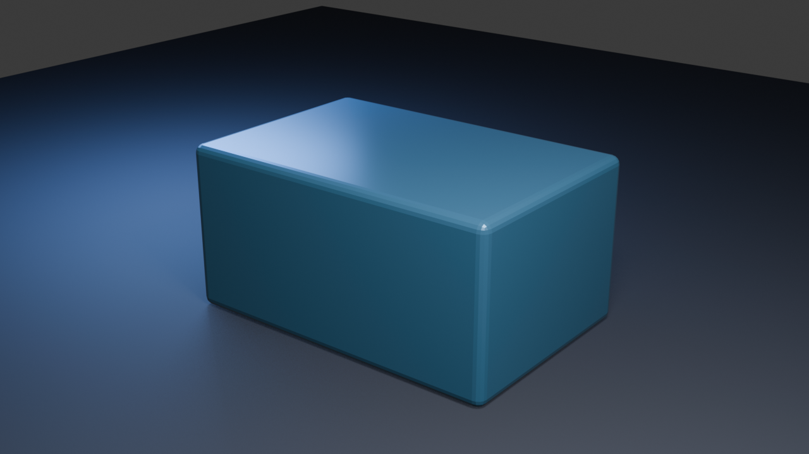

# Kairo Blender Bridge

Kairo Blender Bridge is an artist-facing Blender extension for validating and
publishing production assets into the Kairo asset pipeline. It is one part of
the multi-DCC Kairo Production Tools portfolio.



## Current verified host

- Blender 5.2.0 LTS
- Bundled Python 3.13.13
- macOS Apple Silicon

## Native development smoke test

```bash
/Applications/Blender.app/Contents/MacOS/Blender \
  --background --factory-startup \
  --python tests/run_blender_tests.py
```

The initial increment registers an installable extension panel and persistent
scene settings. The current vertical slice validates a static asset, navigates
and safely fixes supported problems, exports separate glTF, fingerprints every
payload, supports dry-run planning, and publishes through an atomic rename.

## Build an installable extension

```bash
python3 scripts/build_extension.py \
  --core-source ../KairoPipelineCore \
  --blender /Applications/Blender.app/Contents/MacOS/Blender
```

This builds the pinned `KairoPipelineCore` wheel and packages it inside
`dist/kairo_blender-0.1.0.zip`. Generated wheels and packages are deliberately
excluded from Git; CI publishes the ready-to-install zip as an artifact.

## Reproduce the portfolio scene

After installing and enabling the extension:

```bash
/Applications/Blender.app/Contents/MacOS/Blender \
  --background --python examples/create_portfolio_scene.py
```

The script creates a redistributable scene from primitives, validates the
selected asset with zero diagnostics, saves the `.blend` inside ignored
`test-output/`, and renders a 1280×720 result there. Normal example/acceptance
runs never modify the tracked documentation image.

Maintainers may intentionally refresh the checked-in screenshot with:

```bash
KAIRO_UPDATE_DOC_IMAGE=1 \
  /Applications/Blender.app/Contents/MacOS/Blender \
  --background --python examples/create_portfolio_scene.py
```

Review that binary diff before committing it.

See [the artist workflow](docs/ARTIST_WORKFLOW.md) for validation, safe fixes,
dry-run behavior, publication, and failure recovery.


## Source learning pathway

Follow [the linked reading order](docs/SOURCE_READING_ORDER.md) to study the public interfaces, implementations, tests and cross-repository dependencies in a deliberate sequence. It explains what each subsystem owns, where its outputs go, and which behaviors require verification. Distinguish C++23 module interfaces, actual backend implementations and planned APIs.

## Open-source learning and extension

Original project code is available to learn from, modify and develop further under the applicable [LICENSE](LICENSE). Keep copyright/license notices when redistributing substantial portions. Dependencies, code adapted from other sources, media, datasets, models and other third-party materials remain subject to their original licenses. Consult [STATUS.md](STATUS.md) for evidence limitations rather than treating documentation or an unverified completion target as a guarantee of functionality.
